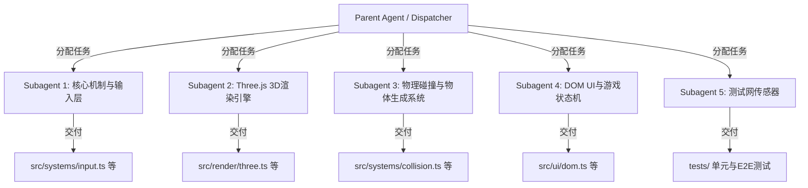

# AGENTS.md — paoku（跑酷）项目主入口与调度导航

> **项目名称**：paoku (Web 3D 跑酷游戏)  
> **范式说明**：本项目严格遵循 [Harness Engineering](https://github.com/deusyu/harness-engineering) 范式。主 Agent 仅作为**任务调度者 (Dispatcher)** 与系统边界约束者。具体的 3D 渲染、物理引擎、UI 逻辑与测试由职责单一的独立 **Subagent** 协作完成。

---

## 🧭 项目导航与核心规范 (Progressive Disclosure)

为避免大模型上下文污染或产生幻觉，子 Agent 介入模块时，**必须首先查阅 `docs/` 目录下对应的专业规范文档**：

| 视角 / 角色 | 目标说明 | 对应规范文档 |
| :--- | :--- | :--- |
| **产品经理 (PM)** | 跑酷核心玩法、金币收集、速度递增机制与 UI/交互 | [V4_PRODUCT_DOCUMENT.md](docs/V4_PRODUCT_DOCUMENT.md) |
| **技术架构师 (Architect)** | Vite + TypeScript 工程配置、模块解耦与状态管理 | [ARCHITECTURE_DESIGN.md](docs/ARCHITECTURE_DESIGN.md) |
| **系统工作流 (Workflow)** | 核心游戏循环 (Game Loop)、事件系统与生命周期 | [SYSTEM_WORKFLOW_SPEC.md](docs/SYSTEM_WORKFLOW_SPEC.md) |
| **测试与传感器 (QA)** | 自动化测试用例、Linter 护栏与物理碰撞的断言标准 | [TEST_PLAN_AND_SENSORS.md](docs/TEST_PLAN_AND_SENSORS.md) |
| **脚手架规范 (Harness)** | 代理调度的约束与 Fail-Refine (Ralph Cycle) 闭环 | [HARNESS_ENGINEERING_REPORT.md](docs/HARNESS_ENGINEERING_REPORT.md) |

---

## 🤖 调度者 (Dispatcher) 指导方针与 Subagent 划分

在开发新功能或修复问题时，任务将被下发给以下几种专职 Subagent。各个 Subagent 之间严格隔离，仅通过约定的接口或事件总线 (Event Bus) 通信。

### 1. `subagent-core-logic`: 核心控制与系统调度
- **职责**：实现主循环（`requestAnimationFrame`）、全局键盘/触摸事件监听、时间增量（Delta Time）计算以及积分累计逻辑。
- **约束**：只能修改核心系统层，禁止直接操作 DOM 或 3D Scene 对象。

### 2. `subagent-3d-render`: 渲染管线 (Three.js)
- **职责**：场景搭建、摄像机跟随、光照、角色模型与地形材质、环境粒子特效以及纹理（`textures.ts`）的加载。
- **约束**：仅通过状态层或事件接收指令（如“角色向左移动”），绝不直接绑定 DOM 键盘事件。

### 3. `subagent-physics`: 物理、碰撞与生成器 (Spawner)
- **职责**：动态生成前方地形、障碍物、金币、磁铁道具；实现包围盒（BoundingBox）碰撞检测算法，通知游戏结束。
- **约束**：纯逻辑与数学计算层，必须确保算法高效无卡顿。

### 4. `subagent-dom-ui`: 前端 DOM 界面与状态展示
- **职责**：覆盖在 Canvas 上的排行榜、分数面板、开始/结束弹窗以及音频（Audio）的控制。
- **约束**：通过 HTML/CSS (如 Tailwind 或原生) 实现，与 Three.js 画布严格在层级上脱耦。

### 5. `subagent-tester`: 护栏铺设员与 QA
- **职责**：使用 Playwright 编写 E2E 测试，或编写单元测试用例。在功能开发前先铺设“传感器”。
- **约束**：输出详细报错日志引导开发 Agent 修复代码。

---

## 🛠 机械化约束与质量守护 (Mechanical Enforcement)

1. **测试即门禁 (Test-Driven Enforcement)**：
   - 任何模块逻辑的重构必须先编写测试脚本。
   - 所有功能的交付以 `npm run test` 等命令的成功退出为唯一完工指标。
2. **只读与白名单**：子 Agent 禁止在未经允许的情况下阅读整个代码库，仅按需读取相关的单一 TS 文件。
3. **闭环修复**：若 Agent 的代码未通过编译或 Linter，它必须查阅终端报错日志自主进行修复（Ralph Cycle），不要向人类求助语法错误。
4. **自动化验收闭环**：每次代码修改完成后，必须立即自主运行编译器检查（如 `tsc`）和单元测试（如 `vitest`）。如发现任何问题，必须立即启动自动修复流程直至通过全部测试。这个规则已固化。
