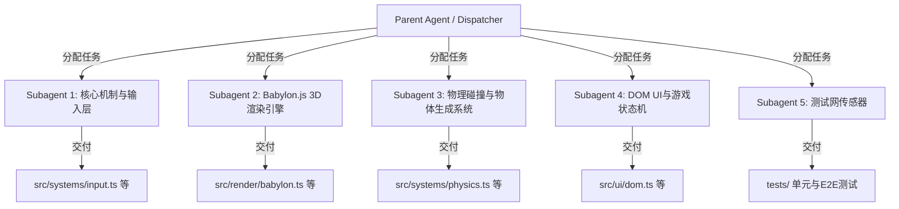

# AGENTS.md — paoku（跑酷）项目主入口与调度导航

> **项目名称**：paoku (Web 3D 跑酷游戏)  
> **范式说明**：本项目融合两套方法论协同工作——
> 1. **Harness Engineering**（Dispatcher + 隔离 Subagent 协作）；
> 2. **obra/superpowers**（AI 编码 Agent 技能框架，v6.3.0，已安装至 `~/.workbuddy/skills/`，详见 [`docs/SUPERPOWERS_WORKFLOW.md`](docs/SUPERPOWERS_WORKFLOW.md)）。
>
> 主 Agent 仅作为**任务调度者 (Dispatcher)** 与系统边界约束者。具体的 3D 渲染、物理引擎、UI 逻辑与测试由职责单一的独立 **Subagent** 协作完成。

---

## 🧭 项目导航与核心规范 (Progressive Disclosure)

为避免大模型上下文污染或产生幻觉，子 Agent 介入模块时，**必须首先查阅 `docs/` 目录下对应的专业规范文档**：

| 视角 / 角色 | 目标说明 | 对应规范文档 |
| :--- | :--- | :--- |
| **产品经理 (PM)** | 跑酷核心玩法、金币收集、速度递增机制与 UI/交互、24 条验收标准 (AC-PRD-01~24) | [PRODUCT_REQUIREMENT_DOCUMENT.md](docs/PRODUCT_REQUIREMENT_DOCUMENT.md) |
| **技术架构师 (Architect)** | Vite + TypeScript 工程配置、模块解耦与状态管理 | [ARCHITECTURE_DESIGN.md](docs/ARCHITECTURE_DESIGN.md) |
| **系统工作流 (Workflow)** | 核心游戏循环 (Game Loop)、事件系统与生命周期 | [SYSTEM_WORKFLOW_SPEC.md](docs/SYSTEM_WORKFLOW_SPEC.md) |
| **测试与传感器 (QA)** | 自动化测试用例、Linter 护栏与物理碰撞的断言标准 | [TEST_PLAN_AND_SENSORS.md](docs/TEST_PLAN_AND_SENSORS.md) |
| **脚手架规范 (Harness)** | 代理调度的约束与 Fail-Refine (Ralph Cycle) 闭环 | [HARNESS_ENGINEERING_REPORT.md](docs/HARNESS_ENGINEERING_REPORT.md) |
| **Superpowers 工作流** | obra/superpowers 技能框架与 WorkBuddy 适配、标准闭环 | [SUPERPOWERS_WORKFLOW.md](docs/SUPERPOWERS_WORKFLOW.md) |

---

## 🤖 调度者 (Dispatcher) 指导方针与 Subagent 划分

在开发新功能或修复问题时，任务将被下发给以下几种专职 Subagent。各个 Subagent 之间严格隔离，仅通过约定的接口或事件总线 (Event Bus) 通信。

### 1. `subagent-core-logic`: 核心控制与系统调度
- **职责**：实现主循环（`requestAnimationFrame`）、全局键盘/触摸事件监听、时间增量（Delta Time）计算以及积分累计逻辑。
- **约束**：只能修改核心系统层，禁止直接操作 DOM 或 3D Scene 对象。

### 2. `subagent-3d-render`: 渲染管线 (Babylon.js)
- **职责**：场景搭建、摄像机跟随、光照、角色模型与地形材质、环境粒子特效以及纹理（`textures`）的加载。
- **约束**：仅通过状态层或事件接收指令（如"角色向左移动"），绝不直接绑定 DOM 键盘事件。入口文件为 `src/render/babylon.ts`（**非** Three.js / `three.ts`）。

### 3. `subagent-physics`: 物理、碰撞与生成器 (Spawner)
- **职责**：动态生成前方地形、障碍物、金币、磁铁道具；在 `src/systems/physics.ts` 中实现包围盒（AABB）碰撞检测与跳跃/翻滚状态机（`checkObstacleCollision` 等），通知游戏结束。
- **约束**：纯逻辑与数学计算层，必须确保算法高效无卡顿。**注意**：碰撞逻辑位于 `src/systems/physics.ts`（**非** `collision.ts`）。

### 4. `subagent-dom-ui`: 前端 DOM 界面与状态展示
- **职责**：覆盖在 Canvas 上的排行榜、分数面板、开始/结束弹窗、任务完成 Toast 以及音频（Audio）的控制。
- **约束**：通过 HTML/CSS 实现，与 Babylon.js 画布严格在层级上脱耦。

### 5. `subagent-tester`: 护栏铺设员与 QA
- **职责**：使用 Vitest 编写单元测试，或使用 Playwright 编写 E2E 测试。在功能开发前先铺设"传感器"。
- **约束**：输出详细报错日志引导开发 Agent 修复代码。

---

## 🔗 Superpowers Skill ↔ Subagent 角色映射

已安装的 14 个 obra/superpowers 技能（`~/.workbuddy/skills/`）与本项目角色绑定如下：

| Superpowers Skill | 绑定角色 / 时机 | 用途 |
| :--- | :--- | :--- |
| `using-superpowers` | Dispatcher（每次会话手动触发；WorkBuddy 无 SessionStart hook） | 声明方法论基线 |
| `brainstorming` | Dispatcher（新功能/重构入口） | 三路径分类 + HARD-GATE 审批 |
| `writing-plans` | Dispatcher（审批后） | 生成可执行实现计划 |
| `writing-skills` | Dispatcher（沉淀可复用流程） | 把 paoku 专属流程固化为 skill |
| `test-driven-development` | Subagent（3A/3B 等） | RED-GREEN-REFACTOR 写单测 |
| `systematic-debugging` | 任意 Subagent（3C） | 先建假设再修 bug |
| `subagent-driven-development` | Dispatcher | 下发隔离任务 |
| `dispatching-parallel-agents` | Dispatcher（独立任务并行） | 提速多文件生成 |
| `executing-plans` | Subagent | 按计划落地 |
| `verification-before-completion` | 所有 Subagent | 完工前自验 |
| `requesting-code-review` / `receiving-code-review` | Dispatcher ↔ Subagent | 关键改动互审 |
| `using-git-worktrees` | Dispatcher（大改动） | 隔离分支 |
| `finishing-a-development-branch` | Dispatcher（收尾） | 合并/收尾 |

---

## 🛠 机械化约束与质量守护 (Mechanical Enforcement)

1. **文档先行即契约 (Doc-Driven Enforcement)**：
   - **在编写任何一行代码之前**，主 Agent 必须首先将功能需求、算法方案和数据结构更新到 `docs/` 目录下对应的核心设计文档（如当前的 PRD）和 `PROGRESS.md` 中。
   - 严禁"先写代码，后补文档"。所有的开发任务必须基于已更新的文档说明下发给 Subagent。
2. **测试即门禁 (Test-Driven Enforcement)**：
   - 任何模块逻辑的重构必须先编写测试脚本。
   - 所有功能的交付以 `npm run test`（`vitest`）等命令的成功退出为唯一完工指标。
3. **只读与白名单**：子 Agent 禁止在未经允许的情况下阅读整个代码库，仅按需读取相关的单一 TS 文件。
4. **闭环修复**：若 Agent 的代码未通过编译或 Linter，它必须查阅终端报错日志自主进行修复（Ralph Cycle），不要向人类求助语法错误。
5. **自动化验收闭环**：每次代码修改完成后，必须立即自主运行编译器检查（如 `tsc`）和单元测试（如 `vitest`）。**必须自己通过测试脚本"模拟跑一次"以捕获任何显而易见的运行时逻辑 Bug。**如发现任何报错或崩溃，必须立即启动自动修复流程直至通过全部测试。这个规则已固化。
6. **视觉验收闭环 (Visual Validation)**：对于涉及 `subagent-3d-render` (3D 渲染/相机取景) 和 `subagent-dom-ui` (前端 DOM 界面布局) 的代码修改，主 Agent 交付前必须启动真实浏览器环境进行验证。必须通过抓取真实页面截图或录屏，自行检查人物取景是否居中合理、UI 布局是否存在溢出或遮挡，确保视觉展示结果符合预期后方可认为任务完成。
7. **全局 E2E 截图测试 (Global Playwright Validation)**：在每次修改代码后，无论修改涉及哪个模块，主 Agent 交付前都要使用 Playwright 运行测试。必须通过生成并查看真实页面截图，自行检查以找出可能存在的任何明显问题。确保没有明显异常后，才能认为任务最终完成。
8. **Superpowers 方法论门禁 (Methodology Gate)**：任何"新功能 / 重构"入口必须先经 `brainstorming` 技能；若为 Architectural / Bounded 路径，须产出设计文档（存放于 `docs/superpowers/specs/`）并经用户审批（HARD-GATE）后，方可进入 `writing-plans` 与实现阶段。严禁跳过审批直接写码。
9. **任务完成后自动提交与推送 (Automatic Commit & Push)**：
   - 用户已授权：每完成一个任务，必须先运行并通过与改动相适应的全部检查。代码改动至少通过 `npm run build`、`npm run test` 和 `npm run test:e2e`，并按上述规则检查真实页面截图；纯文档改动须完成内容审查及 `git diff --check`，无需仅为文档改动运行浏览器测试。
   - 验证通过后，自动将本任务相关改动提交为含义明确的 Git commit，并推送至 `origin` 的当前任务分支，无需逐次向用户确认。首次推送使用 `git push -u origin HEAD`，后续使用 `git push`，遵循 `CONTRIBUTING.md` 的任务分支约定。
   - 提交前检查暂存区，只包含本任务改动，不得捎带用户已有或其他任务未完成的改动；无改动时无需创建空提交。
   - 检查失败时先修复并重新验证，未通过不得提交或推送；禁止以跳过 hooks、强制推送或重写远程历史来完成任务。
   - 推送因认证、网络或远程分支冲突失败时，保留本地成果并明确报告原因，不得声称已同步远程。交付时说明验证结果、提交号、推送分支及是否推送成功。
