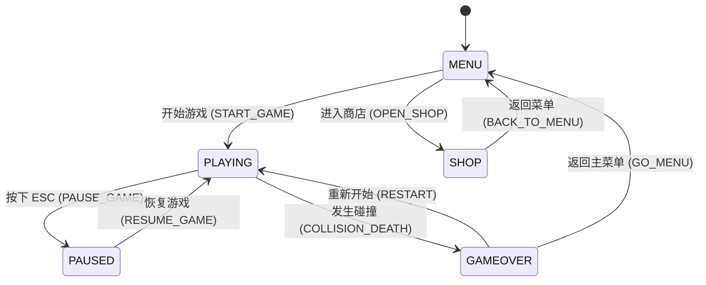

# 系统架构与模块隔离设计 (Architecture Spec)

## 1. 模块解耦与状态机图 (State Machine Diagram)



---

## 2. EventBus 事件通信契约 (Event Bus Contracts)

系统核心逻辑与 UI/音效完全基于发布-订阅模式（EventBus）脱耦：

| 事件名称 | 触发时机 | Payload 负载说明 |
| :--- | :--- | :--- |
| `STATE_CHANGED` | 游戏状态发生变更时 | `{ oldState: GameState, newState: GameState }` |
| `COLLISION` | 玩家击中障碍物/金币/道具时 | `{ targetType: string, position: {x,y,z} }` |
| `COIN_COLLECTED` | 拾取金币时 | `{ value: number, total: number }` |
| `POWERUP_ACTIVATED` | 激活磁铁/滑板等道具时 | `{ type: PowerUpType, duration: number }` |
| `PLAYER_ACTION` | 触发跳跃/翻滚/换道时 | `{ action: 'JUMP' | 'ROLL' | 'CHANGE_LANE', value?: number }` |

---

## 3. 目录与职责划分 (Directory Boundaries)

*   `/src/core`：主循环 (`gameLoop.ts`) 与全局事件总线 (`eventBus.ts`)。
*   `/src/entities` 或 `/src/types`：纯 TypeScript 数据接口定义与状态 Context。
*   `/src/systems`：无状态纯函数逻辑层（`physics.ts`, `input.ts`, `spawner.ts`, `audio.ts`, `mission.ts`）。
*   `/src/render`：Babylon.js 商业 3D 场景、Glow 辉光、PBR 材质、阴影与视效 (`babylon.ts`)。
*   `/src/ui`：DOM 覆盖层与交互控制 (`dom.ts`)。

## 4. 核心状态机 (State Machine)
```typescript
export enum GameState {
  Menu = 'MENU',
  Playing = 'PLAYING',
  GameOver = 'GAMEOVER'
}
```

## 5. 实体数据结构 (Entities)
```typescript
export type Lane = 0 | 1 | 2; // 左中右三条跑道

export enum PlayerState {
  Running = 'RUNNING',
  Jumping = 'JUMPING',
  Rolling = 'ROLLING'
}

export interface Player {
  lane: Lane;
  y: number; // 逻辑前行距离
  z: number; // 高度（用于跳跃/下蹲逻辑）
  state: PlayerState;
  stateTimer: number; // 状态持续时间倒计时
}

export enum EntityType {
  Obstacle = 'OBSTACLE',
  Coin = 'COIN'
}

export interface GameEntity {
  id: string;
  type: EntityType;
  lane: Lane;
  y: number; // 实体在跑道上的逻辑位置
  width: number;
  length: number; // Y轴深度
  height: number; // Z轴高度
  isCollected?: boolean; // 金币专属标记
}
```

## 3. 全局游戏状态树 (Global Game State)
```typescript
export interface GameContext {
  state: GameState;
  score: number;
  time: number;
  speed: number;
  
  player: Player;
  entities: GameEntity[];
}
```
