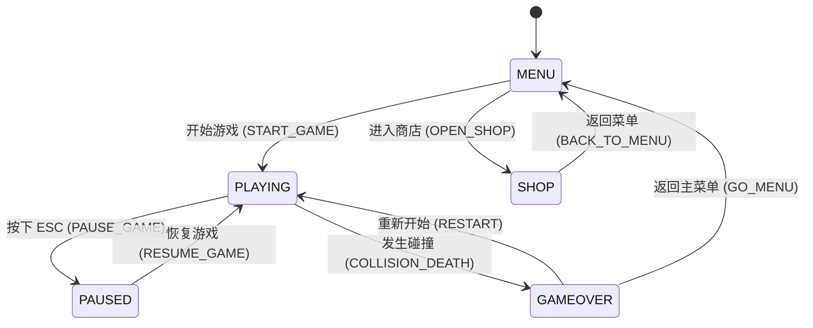

# 系统架构与模块隔离设计 (Architecture Spec)

## 2026-11-04 两桥限定实施写权

[用户已批准范围及执行计划](plans/2026-11-04-pao18-pao19-approved-bridge-execution.md)第2节开放18的contracts/simulation、input与physics观测、main及三个render消费者，采用MotionFact/Stamp/Batch/Cursor/Read/Receipt最小子集，impact未知保持null；不改碰撞/支撑/动作合法性/奖励或audio/application。journal预算256批/1024事件、单tick64 draft，main音频暂存256调用及交付重入屏障/异常局保护纳入限定范围。19第3节仅dom.ts布局producer和新presentation/hudSafeArea.ts纯值模块/新测试；main/render/types/业务仍只读。19布局producerId/epoch/revision不与18事实身份混用。公共接线后续由主Agent统一，当前不merge。明确未就绪/坐标/包络与冻结策略按批准设计保留，不重构solver；本节覆盖旧相应“未授权实施”，不是全库写权。

## 2026-11-03 用户延期车尾修复及派生预览排查

用户明确要求车尾问题先记录、当前不继续修复。以[已知问题KI-001/002](KNOWN_ISSUES.md)和[暂停收口提示词](plans/2026-11-03-roof-exit-deferred-handoff.md)为当前指令：保留本地未提交候选与所有失败证据，不再修复/追查/重复复验车尾及连带ready超时，不回滚、提交或丢弃现有改动。以下历史车尾实施/补充诊断安排暂停；字体任务独立授权不变。延期不表示修复已验收、原失败已关闭或全套测试通过，恢复须用户明确要求。

## 2026-11-03 批准后的独占修复写权

[批准执行计划](plans/2026-11-03-regression-remediation-execution.md)固定车尾诊断树8af24af、字体诊断树e6a52b1，两个现有树复用，生产写权只在本树生效。车尾限physics.ts的isSupportSweep/已有departure提交、sweptCollision新增行为断言和新专属E2E；复用owner/side/y，只在已证向下顶面接触且终点向外越界/仍重叠同owner时保留跨tick连续性，重入/追上/分离/回收语义维持。surfaces/公共types/步序不开放。

字体限index.html的字体外链、style.css字体导入/声明/路径、新public/fonts及来源/许可清单、新专属unit/E2E；固定不可变revision与具体二进制hash/许可/weight/字符覆盖/缓存版本。旧错误传感器、main/render/physics/19 UI/依赖/默认配置只读。PWA配置若实证漏缓存需最小扩围，不推定开放。新计划/证据路径按执行计划，其他活动树/原诊断证据只读；不自动移植或合并。本节优先于下文历史仅文本诊断限制。

## 2026-11-03 回归诊断隔离与数据边界

[诊断计划](plans/2026-11-03-regression-diagnosis-prompts.md)使用新linked worktree：pao-15-roof-diagnosis@614179d与pao-18-font-diagnosis@5bd31cc。生产源码/旧测试/资产/依赖和原任务树只读；跟踪写权仅各自新报告和纯文本证据，临时QA仅本树既有忽略目录。车尾诊断读取固定步状态/支撑与sweep事实，不修改模拟权威或公共schema；字体诊断记录CSS/字体请求链/发起者/状态/错误，不修改UI或生产资源。主Agent已建立含SHA的原始只读输入清单；后续修复另定单一写入者及最小白名单，不直接在原15/18树越权改代码。

## 2026-11-03 PAO-15/18 A方案实施写权

本批已交付15@614179d及18@5bd31cc，主Agent独立检查：[15独立主审](reviews/2026-11-03-pao15-basic-motion-sample-review.md)build/269单测通过、完整E2E45/46（旧车尾下降碰撞）；[18独立主审](reviews/2026-11-03-pao18-controller-camera-review.md)build/292单测及新增7项E2E通过、完整59/60（旧字体网络错误）。两项最终验收暂缓，不重复派发已完成制作/工程批次，不以技术子集或旧成绩代替完整门禁；后续先调查/处理失败并完整复验，未授权新资产/I-03/HUD集成。以下为已批准范围及持续生效的技术契约。

[批准执行计划与完整提示词](plans/2026-11-03-pao15-pao18-approved-execution.md)复用15@8c4b09f与18@f2680f4，均已推送且干净。15只写新派生工程/四clip导出及manifest/专属工具测试证据；18只写characterView/cameraRig/babylon及新专属测试证据。主Agent只规划/准备/验收，旧资产和旧测试只读，不合并15/19。

15保持23骨rest/skin/IBM，manifest登记固定来源/产物hash、骨架/clip版本、30fps区间/边界键、坐标/手性、marker和质量限制。root复制模拟presentation，局部骨姿不决定世界位移/接触/无敌。18保留17资源生命周期，角色实例和相机状态分属各组件；只读同帧身份/context/bounds。main/types/physics/总线/UI/assets/environment/entityViews默认只读；I-03、时间秒数透传、动态HUD及生产资产注册另提最小请求并由唯一入口写入者串行实施。

## 2026-11-02 PAO-17主题/坡面本批写权

[本批批准计划](plans/2026-11-02-pao17-bright-theme-execution.md)固定536f54b，仅environment/entityViews/babylon及必要assets和新专属测试可写；main/types/modelBindings/core/systems/application/DOM/public/依赖/默认配置/旧测试保持只读。原I-01/I-02沿用，不重做接线。主题池由playerZ绝对段索引驱动，背景不占模拟RNG/生成权威；独立展台按既有应用状态显隐。

楔形顶面按obs底面中心/宽高深生成，程序车顶板在表现层铺满ROOF范围并对齐高度，读已验收Surface作测试基准，不修改物理尺寸/容差。资源/材质/Glow/caster有单一归属，段回收/reset/dispose都清理引用；四件GLB候选、18镜头/正式动作和跨分支整合继续递延。

## 2026-11-02 PAO-17批准后A→B串行写权

[本批计划](plans/2026-11-02-pao17-approved-execution.md)固定pao-17@fcddba1495a27436de64971720aad67624bc4420，由原17聊天单一实现方执行。A独占babylon/assets/environment/entityViews及专属测试，先保留门面并明确加载容器/实例/共享材质/阴影/订阅的归属、失效与幂等释放；完成完整验证检查点后B独占main的render/legacyView必要取样参数和disposeGame最小接线。Dispatcher仍只写文档与验收。

只读帧身份`{runId,tick,discontinuity,appState}`类型在渲染模块定义，复用现有类型，shared types只读；context和模拟身份取自同一次presentation(alpha)，应用状态在同次同步调用投影，位移不再次插值。disposeGame调用幂等renderer.dispose，eventBus回调保存身份后off；只移除自己创建的Canvas。main其他业务、application/core/physics/modelBindings/DOM/public/依赖和共享配置不开放。合成夹具与生产绑定分开，renderer缓存与旧消费者资格分开，18角色/相机路径继续递延。

## 2026-11-02 PAO-16/17 并行写权

[并行交接](plans/2026-11-01-pao16-pao17-parallel-prompts.md)：16接续3de6e54，只改专属标定工具/测试及新refinement诊断证据，原src/public/首批诊断证据只读；17从19aa314分析实际渲染门面，只写任务级设计/接口验收方案。17目录已建立，但不是正式实现基线或运行环境签收；两树互不写入/合并，main/types/共享总纲无并行写权。

## 2026-11-01 PAO-16 标定探针边界

[独立标定工具](plans/2026-11-01-pao16-calibration-spike.md)只读取既有GLB和M1逻辑，输出有证据/置信度的测点、候选矩阵与误差分类，不改src/public或生产模型绑定。source节点/loader手性/asset→logic重基各转换一次；工程车组合单视觉根，逻辑RAMP/ROOF仍独立。非等比/不可拟合须诊断，不能反改物理或拿外框匹配当表面对齐通过。

## 2026-11-01 PAO-15 试样隔离

[已批准局部试样](plans/2026-11-01-pao15-rig-spike.md)保留pao-15@8b26bdf，不合并PAO-19。原GLB只读，派生DCC/导出/校验工具分别在专属目录，独立Babylon预览不修改src/public/main/render。数据记录source/derived hash、骨架/权重/逆绑定矩阵、源→引擎变换及姿势证据；动画仅变形，不获得模拟位移或碰撞权威。试样不是正式运行时资产注册或PAO-18接线放行。

## 2026-11-01 PAO-19 已批准实现边界

用户已批准[UI方案A、适用UI风格与I-01/I-02](plans/2026-11-01-pao19-approved-execution.md)，本节对PAO-19优先于旧准备白名单。单一PAO-19实现方在原独立工作树串行A→B：A写dom/views/style、专属测试及HTML仅viewport-fit/lang；接口与完整回归检查点后，B独占main.ts的命令生命周期最小接线。其他聊天不得并写main，Dispatcher只写文档与验收。

UIManager保留现有公开门面；新增只读pending/result接收接口与原commandId/type/runId关联，复用既有CommandResult。业务事务/存档schema/共享types/模拟与渲染不开放修改；UI无application实例或钱包权威。递延命令去重、旧局回执隔离、失败显式重试身份与字段音频意图须由测试证明，不能凭新反馈重做事务。

## 2026-11-01 M2 调度准备边界

[M2分工/白名单/手动提示词](plans/2026-11-01-m2-dispatch-preparation.md)以已验收M1实现19aa314为接续基线；本规划树旧源码不作为M2实现起点。15角色资产、16场景标定、19DOM UI先独立准备，17待16、18待15/17，均不因目录准备而自动放行实现。

- 模拟/应用保留唯一权威；M1实际AppSnapshot/AppCommand及PAO-13显式模型绑定优先于历史接口示例。资产scene bounds不成为碰撞参数，标定在表现边界转换一次。
- 渲染17拥有assets/environment/entityViews与babylon入口，18接续其characterView/cameraRig；两者不同时写babylon.ts。19限DOM/views/CSS，经现有应用意图桥接入，application服务、main/types只读。
- 共享入口若确需修改，由Dispatcher先明确契约与互斥白名单，再串行派给单一实现方；主Agent不编写游戏实现。跨分支资产/代码由专门集成任务汇合，不自动合并main。
- 本节是调度契约，不宣称正式风格/真机预算/新GLB标定已冻结。具体设计及共享文档先批准、同步，再进入任务实现。

## 2026-10-31 M1 审查生效口径（限定 PAO-10）

[PAO-7/8/9 一致性审查](reviews/2026-10-31-pao-7-8-9-consistency.md)允许规划 PAO-10；本节为本批技术契约，优先于下文历史示例。正式美术、机型/帧率承诺与玩法假设仍待人工冻结。总体方案已批准，本次仅文档交接，未实现新接口。

- 坐标为 X 横向向右、Y 世界高度向上、Z 前进；1单位=1m，速度m/s、加速度m/s²。玩家位置是脚底中心，实体是底面中心；禁止按旧示例交换当前实现轴向。车道中心为[-3,0,3]，碰撞使用实际位置。
- 数据目标为 PlayerMotion、Surface、ObstacleDefinition、TrackSegment、RunState、PresentationEvent；完整字段依据[PAO-9固定契约](https://github.com/yboo2049-source/paoku/blob/2eac04b317bbda3e3a97d8fad694926fcfd43ae0/docs/architecture/rebuild-contracts.md)。PAO-10仅引入其必需子集，其余模块在对应任务迁移，不一次替换全库。
- 设备输入只生成带runId/tick/sequence的命令；模拟拥有唯一可写状态，渲染/UI/音频读取深只读快照。RunPhase与应用页面状态分开。时间为tick×stepSec，不从渲染帧推进游戏计时。
- 目标事实事件带contractVersion/eventId/runId/tick/sequence/timeSec/type/payload，ACTION_STARTED、PLAYER_LANDED、PICKUP_CONSUMED等以PAO-9第6节为准。下文STATE_CHANGED/value等为旧设计示例，不是当前实际emit或新版承诺；旧桥只能单向且同一事实不得双发。
- COIN拾取统一status；pickupCount、pickupCoins、rewardCoins分账，收益为后两者之和；任务不从表现事件发钱。积分兼容0.1×里程×倍率，不因固定步改玩法。存档与交易仍归PAO-14。
- PAO-10路径限于JSON prompt白名单；main.ts/types/index.ts只做核心接线，不整合应用交易、物理重构或渲染。PAO-14共享入口串行，待PAO-10审查交接；三份送审分支只读、不合并。

完整差异裁定、来源行号及人工待决项以审查报告为准；不把本批技术交接等同PAO-7/8/9最终人工验收。

## 1. 模块解耦与状态机图 (State Machine Diagram)



---

## 2. EventBus 事件通信契约 (Event Bus Contracts)

系统核心逻辑与 UI/音效完全基于发布-订阅模式（EventBus）脱耦：

| 事件名称 | 触发时机 | Payload 负载说明 |
| :--- | :--- | :--- |
| `STATE_CHANGED` | 游戏状态发生变更时 | `{ oldState: GameState, newState: GameState }` |
| `COLLISION` | 玩家击中障碍物/金币/道具时 | `{ targetType: string, position: {x,y,z} }` |
| `COIN_COLLECTED` | 拾取金币时 | `{ value: number, total: number }` |
| `POWERUP_ACTIVATED` | 激活磁铁/滑板等道具时 | `{ type: PowerUpType, duration: number }` |
| `PLAYER_ACTION` | 触发跳跃/翻滚/换道时 | `{ action: 'JUMP' | 'ROLL' | 'CHANGE_LANE', value?: number }` |

---

## 3. 目录与职责划分 (Directory Boundaries)

*   `/src/core`：主循环 (`gameLoop.ts`) 与全局事件总线 (`eventBus.ts`)。
*   `/src/entities` 或 `/src/types`：纯 TypeScript 数据接口定义与状态 Context。
*   `/src/systems`：无状态纯函数逻辑层（`physics.ts`, `input.ts`, `spawner.ts`, `audio.ts`, `mission.ts`）。
*   `/src/render`：Babylon.js 商业 3D 场景、Glow 辉光、PBR 材质、阴影与视效 (`babylon.ts`)。
*   `/src/ui`：DOM 覆盖层与交互控制 (`dom.ts`)。

## 4. 核心状态机 (State Machine)
```typescript
export enum GameState {
  Menu = 'MENU',
  Playing = 'PLAYING',
  GameOver = 'GAMEOVER'
}
```

## 5. 实体数据结构 (Entities)
```typescript
export type Lane = 0 | 1 | 2; // 左中右三条跑道

export enum PlayerState {
  Running = 'RUNNING',
  Jumping = 'JUMPING',
  Rolling = 'ROLLING'
}

export interface Player {
  lane: Lane;
  y: number; // 逻辑前行距离
  z: number; // 高度（用于跳跃/下蹲逻辑）
  state: PlayerState;
  stateTimer: number; // 状态持续时间倒计时
}

export enum EntityType {
  Obstacle = 'OBSTACLE',
  Coin = 'COIN'
}

export interface GameEntity {
  id: string;
  type: EntityType;
  lane: Lane;
  y: number; // 实体在跑道上的逻辑位置
  width: number;
  length: number; // Y轴深度
  height: number; // Z轴高度
  isCollected?: boolean; // 金币专属标记
}
```

## 3. 全局游戏状态树 (Global Game State)
```typescript
export interface GameContext {
  state: GameState;
  score: number;
  time: number;
  speed: number;
  
  player: Player;
  entities: GameEntity[];
}
```
