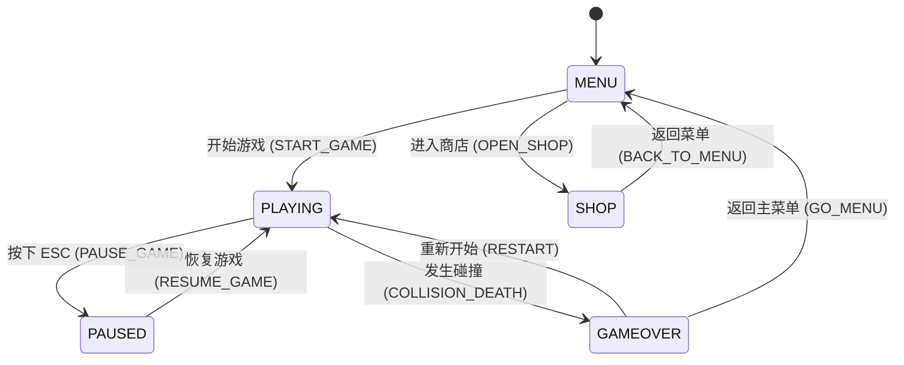

# 系统架构与模块隔离设计 (Architecture Spec)

## 2026-11-01 M2 调度准备边界

[M2分工/白名单/手动提示词](plans/2026-11-01-m2-dispatch-preparation.md)以已验收M1实现19aa314为接续基线；本规划树旧源码不作为M2实现起点。15角色资产、16场景标定、19DOM UI先独立准备，17待16、18待15/17，均不因目录准备而自动放行实现。

- 模拟/应用保留唯一权威；M1实际AppSnapshot/AppCommand及PAO-13显式模型绑定优先于历史接口示例。资产scene bounds不成为碰撞参数，标定在表现边界转换一次。
- 渲染17拥有assets/environment/entityViews与babylon入口，18接续其characterView/cameraRig；两者不同时写babylon.ts。19限DOM/views/CSS，经现有应用意图桥接入，application服务、main/types只读。
- 共享入口若确需修改，由Dispatcher先明确契约与互斥白名单，再串行派给单一实现方；主Agent不编写游戏实现。跨分支资产/代码由专门集成任务汇合，不自动合并main。
- 本节是调度契约，不宣称正式风格/真机预算/新GLB标定已冻结。具体设计及共享文档先批准、同步，再进入任务实现。

## 2026-10-31 M1 审查生效口径（限定 PAO-10）

[PAO-7/8/9 一致性审查](reviews/2026-10-31-pao-7-8-9-consistency.md)允许规划 PAO-10；本节为本批技术契约，优先于下文历史示例。正式美术、机型/帧率承诺与玩法假设仍待人工冻结。总体方案已批准，本次仅文档交接，未实现新接口。

- 坐标为 X 横向向右、Y 世界高度向上、Z 前进；1单位=1m，速度m/s、加速度m/s²。玩家位置是脚底中心，实体是底面中心；禁止按旧示例交换当前实现轴向。车道中心为[-3,0,3]，碰撞使用实际位置。
- 数据目标为 PlayerMotion、Surface、ObstacleDefinition、TrackSegment、RunState、PresentationEvent；完整字段依据[PAO-9固定契约](https://github.com/yboo2049-source/paoku/blob/2eac04b317bbda3e3a97d8fad694926fcfd43ae0/docs/architecture/rebuild-contracts.md)。PAO-10仅引入其必需子集，其余模块在对应任务迁移，不一次替换全库。
- 设备输入只生成带runId/tick/sequence的命令；模拟拥有唯一可写状态，渲染/UI/音频读取深只读快照。RunPhase与应用页面状态分开。时间为tick×stepSec，不从渲染帧推进游戏计时。
- 目标事实事件带contractVersion/eventId/runId/tick/sequence/timeSec/type/payload，ACTION_STARTED、PLAYER_LANDED、PICKUP_CONSUMED等以PAO-9第6节为准。下文STATE_CHANGED/value等为旧设计示例，不是当前实际emit或新版承诺；旧桥只能单向且同一事实不得双发。
- COIN拾取统一status；pickupCount、pickupCoins、rewardCoins分账，收益为后两者之和；任务不从表现事件发钱。积分兼容0.1×里程×倍率，不因固定步改玩法。存档与交易仍归PAO-14。
- PAO-10路径限于JSON prompt白名单；main.ts/types/index.ts只做核心接线，不整合应用交易、物理重构或渲染。PAO-14共享入口串行，待PAO-10审查交接；三份送审分支只读、不合并。

完整差异裁定、来源行号及人工待决项以审查报告为准；不把本批技术交接等同PAO-7/8/9最终人工验收。

## 1. 模块解耦与状态机图 (State Machine Diagram)



---

## 2. EventBus 事件通信契约 (Event Bus Contracts)

系统核心逻辑与 UI/音效完全基于发布-订阅模式（EventBus）脱耦：

| 事件名称 | 触发时机 | Payload 负载说明 |
| :--- | :--- | :--- |
| `STATE_CHANGED` | 游戏状态发生变更时 | `{ oldState: GameState, newState: GameState }` |
| `COLLISION` | 玩家击中障碍物/金币/道具时 | `{ targetType: string, position: {x,y,z} }` |
| `COIN_COLLECTED` | 拾取金币时 | `{ value: number, total: number }` |
| `POWERUP_ACTIVATED` | 激活磁铁/滑板等道具时 | `{ type: PowerUpType, duration: number }` |
| `PLAYER_ACTION` | 触发跳跃/翻滚/换道时 | `{ action: 'JUMP' | 'ROLL' | 'CHANGE_LANE', value?: number }` |

---

## 3. 目录与职责划分 (Directory Boundaries)

*   `/src/core`：主循环 (`gameLoop.ts`) 与全局事件总线 (`eventBus.ts`)。
*   `/src/entities` 或 `/src/types`：纯 TypeScript 数据接口定义与状态 Context。
*   `/src/systems`：无状态纯函数逻辑层（`physics.ts`, `input.ts`, `spawner.ts`, `audio.ts`, `mission.ts`）。
*   `/src/render`：Babylon.js 商业 3D 场景、Glow 辉光、PBR 材质、阴影与视效 (`babylon.ts`)。
*   `/src/ui`：DOM 覆盖层与交互控制 (`dom.ts`)。

## 4. 核心状态机 (State Machine)
```typescript
export enum GameState {
  Menu = 'MENU',
  Playing = 'PLAYING',
  GameOver = 'GAMEOVER'
}
```

## 5. 实体数据结构 (Entities)
```typescript
export type Lane = 0 | 1 | 2; // 左中右三条跑道

export enum PlayerState {
  Running = 'RUNNING',
  Jumping = 'JUMPING',
  Rolling = 'ROLLING'
}

export interface Player {
  lane: Lane;
  y: number; // 逻辑前行距离
  z: number; // 高度（用于跳跃/下蹲逻辑）
  state: PlayerState;
  stateTimer: number; // 状态持续时间倒计时
}

export enum EntityType {
  Obstacle = 'OBSTACLE',
  Coin = 'COIN'
}

export interface GameEntity {
  id: string;
  type: EntityType;
  lane: Lane;
  y: number; // 实体在跑道上的逻辑位置
  width: number;
  length: number; // Y轴深度
  height: number; // Z轴高度
  isCollected?: boolean; // 金币专属标记
}
```

## 3. 全局游戏状态树 (Global Game State)
```typescript
export interface GameContext {
  state: GameState;
  score: number;
  time: number;
  speed: number;
  
  player: Player;
  entities: GameEntity[];
}
```
