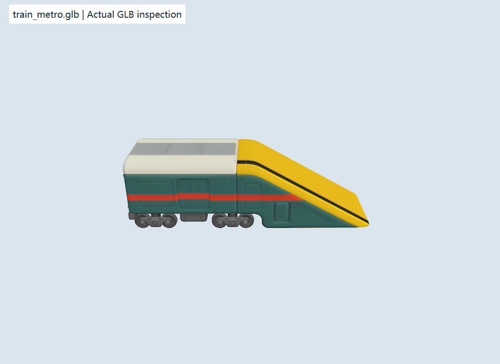
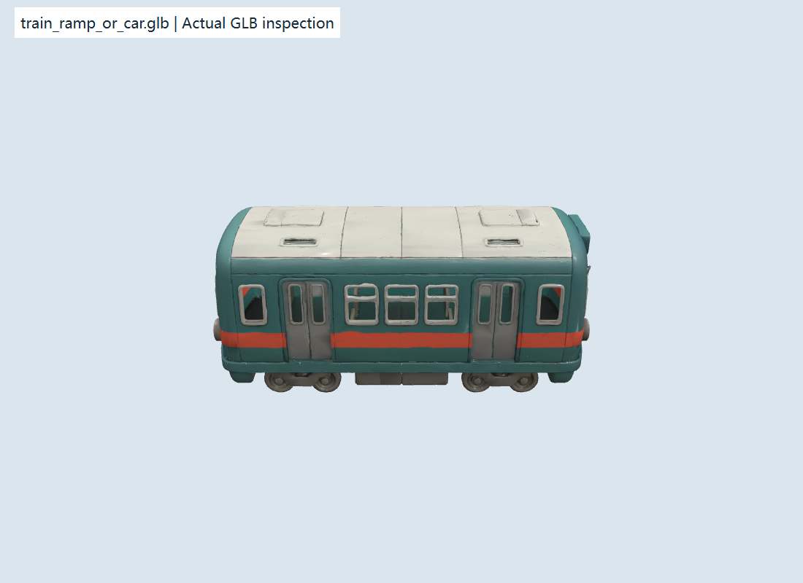

# 远程 GLB 交付与 PAO-13 调整说明

日期：2026-11-01（Asia/Shanghai）。远程输入：`origin/main` 提交 `622e7da`。本轮仅获取、检查资产和更新规划，不修改游戏实现或 PAO-13 工作树。

## 获取与证据

已执行 `git fetch origin --prune`，并建立独立只读审查工作树 `D:/worker/paoku-sessions/glb-review`（detached HEAD，622e7da）。原规划分支及 PAO-13 基线 `6efdd1f` 保持原状，未把落后的 main 游戏实现覆盖到 M1 分支。

该远程提交新增21个GLB、20张概念参考及 docs/PROGRESS.md，未修改 src 加载代码。当前渲染器仍加载旧 `/models/player.glb`；新增文件存在不等于已替换运行时角色和占位物。

证据目录：[检查结果](../evidence/glb-handoff-2026-11-01/metadata.json)。静态统计读取GLB JSON/BIN、节点变换和POSITION；尺寸为原始节点变换后的静态几何包围盒，不是已冻结的游戏米制尺寸、骨骼姿态包围盒或碰撞代理。旧player.glb有蒙皮，不能据本工具的原始POSITION包围盒推断其实际角色高度。

另用现有Babylon.js及glTF加载器在独立本地5190端口导入关键资产，Playwright Chromium/D3D11截图并实际查看；服务和浏览器已关闭。检查未修改游戏渲染器。预览用于确定模型内容和导入情况，不代表游戏同屏品质或真机性能验收。

## 已确认事实

| 项目 | 检查结果 | 影响 |
| --- | --- | --- |
| 新资产数量与体积 | 21个，约149.47MiB GLB | 文件压缩体积不代表首屏或显存达标，不能全量阻塞加载 |
| 新角色 | character_runner/police/dog 均无skins、无animations | 当前是静态角色资产；不能直接宣称跑跳滑铲动画完成 |
| 新资产整体 | 21个均无skins/animations，约143万三角面、41张内嵌图像，所检图像均4096×4096 | 数字是全资产静态清单，不是同屏提交；需要LOD/贴图分档，不能交由生成器隐藏危险来掩盖成本 |
| 关键资产来源语义 | train_metro.glb 实际是带黄色坡道的工程车；train_ramp_or_car.glb 实际是普通车厢 | 文件名与直觉语义相反，必须显式映射，不按文件名推断类型 |
| 火车主轴 | 两个模型原始最大尺寸均在X轴：约0.9995和0.9792 | 导入朝向/比例需单独归一；不能将GLB原始X/Y/Z尺寸直接用作逻辑width/height/depth |
| 角色高度 | runner静态高度约0.9791，逻辑站立高1.8m | 由导入规范确定缩放/脚底和碰撞代理，不改变现有物理来迁就未经标定模型 |
| 支撑与代理 | 未发现具名collision/collider/proxy/socket/support节点；未提供可直接采用的通行端点契约 | 无具名代理不等于证明没有隐藏几何；仍需显式标注可走面、简化代理和连接点 |
| 道具范围 | 新增文件还包括jetpack、shield、mystery_box | 资产到库不授权增加新机制；PAO-13仍只生成现有四种PowerUpType |

实际模型预览：

## PAO-13 的调整

1. 保持原目标：带种子的关卡编排、连续段端口、真实物理可达性与奖励路线，不新增模型加载/动画/渲染工作。
2. 新增数据级显式绑定契约：逻辑definitionId/visualPrefabId、远程提交/模型路径、组合实例ID、逻辑尺寸及导入变换交接状态。建议普通车厢绑定 `train_ramp_or_car.glb`，带坡车组合绑定 `train_metro.glb`；路径只做引用，不在PAO-13导入或修改GLB。
3. 带坡工程车按组合段处理：逻辑坡面与车顶分别验证、共享端点，视觉可以由一个prefab覆盖。记录唯一视觉根和子逻辑实体的归属，避免未来渲染同时生成工程车完整模型与额外重复坡/车。未取得实际可走面标定前，继续使用已验收的逻辑几何；组合视觉绑定标为待校准，不声称正式模型与通行面已对齐。
4. 不能把GLB约1单位的归一化包围盒当作真实米制尺寸，也不能默认全部长轴为Z。采用PAO-9的Y高度/Z前进、底面中心与坡脚重基契约；实际旋转符号、统一/非统一缩放和可走面由导入任务确认。
5. 不根据文件名新增障碍或道具机制；不生成jetpack、独立shield或mystery_box的未知玩法。缺绑定或绑定未验收时沿用明确的逻辑/旧表现回退，不能改变可达性判定或使生成器停摆。
6. 增加数据测试：文件语义映射不反转；组合实例ID与根归属稳定且只引用一次视觉根；同seed/contentRevision仍同布局；未标定raw尺寸不会污染逻辑代理；未支持玩法类型被拒绝。不能用静态文件存在作为运行时加载成功的测试。

本次远程更新无需重写PAO-13种子/可达性算法，也不要求在其工作树合并origin/main。任务所需素材路径和固定提交作为外部输入交接，资产接入应在专门集成阶段与已验收M1基线汇合。

## 下游交接

- PAO-15：明确新角色无骨架/动画，另交绑定与动作；旧player.glb动作不能直接按名称套到无骨架新模型。
- PAO-16：建立经过标定的模型注册表、简化碰撞代理、坡脚/坡顶/车顶端点、朝向/原点/尺度、LOD及贴图分档。普通车厢约112,516三角、警官约147,371三角；尚不符合既定轻量同屏制作分配。RGBA8完整mip估算单张4K约85.33MiB，非GPU实测；实际压缩、驻留和共享按档验证。
- PAO-17/18：加载与实例复用、组合prefab避免重复、导入转换一次、角色动画/镜头整合，在真实游戏中逐项验收。当前远程提交没有完成这些接线。
- PAO-25：149.47MiB不能全放入首屏；首局必要资源分批/延迟加载，按真实传输、CPU/GPU、内存和真机复验。原作者源、许可证与来源记录仍需随资产补齐，不能从文件上传推定已验收。

以上只陈述本轮文件结构和实际导入观察，不评价未检查资产的全部外观、版权或动画质量。具体美术方向继续尊重用户交付，技术归一不擅自重画或重建模型。
