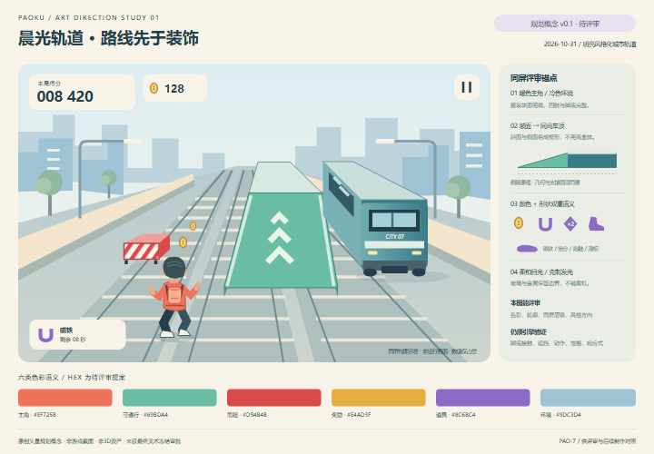

# PAO-7 规划交付与验证报告

日期：2026-10-31（Asia/Shanghai）。工作目录：`D:\worker\paoku-sessions\pao-7`。任务分支：`docs/pao-7-planning`。起始提交：`e8d3101`。Linear 目标状态：In Review，等待人类同屏小样评审；本报告不代表最终风格冻结。

## 交付范围

已读取 PAO-7 描述及最新唯一评论（`1190b04a-fb94-45f5-aa6a-08addd1ce186`）、AGENTS.md、CONTRIBUTING.md、批准的重构设计稿、PRD 与 PAO-6 基线报告/证据索引。PAO-6 已为 Done。Linear 开始执行时由 Backlog 改为 In Progress；提交推送完成后回写并转 In Review。

| 交付 | 内容与状态 |
|---|---|
| [风格与制作规格](../../art/rebuild-style-guide.md) | 六类语义色及禁忌、比例、材质/灯光、坡道/车顶一致性、HUD、建模/贴图/动作和制作预算；具体参数待评审 |
| [资产与来源登记](../../art/pao-7-asset-register.md) | 玩法优先级、旧资产线索与许可缺口、拟制作来源、源文件/导出/许可证字段；未把待制作模型算为完成 |
| [同屏可编辑 SVG](../../art/pao-7-same-screen-concept.svg) | 原创角色、列车、真实楔形坡的概念表现、环境和 HUD 同屏；包含六色板及道具形状 |
| [共享整合建议](../../art/pao-7-integration-notes.md) | PRD、PROGRESS、总纲与测试规范的建议交给主聊天；未直接改共享文件 |

仅新增本任务文档、SVG 和预览证据。不改 `src/`、`public/`、游戏测试、配置、依赖或其他任务分支。无新工作树，无合并其他分支。PAO-8 负责最终预算，PAO-9 负责坐标/支撑/事件契约；本次不代替其决策。

## 验证记录

| 检查 | 结果与边界 |
|---|---|
| 内容审查 | 逐项对照任务：同屏五元素、六语义及禁忌、建模/贴图/动作、资产来源与许可字段覆盖；独立审查发现并修正动作数量与核心页面优先级，旧文件来源补登记 |
| SVG 静态检查 | XML 可解析，1440×1000 与 viewBox 一致，六主色齐全，无脚本和外部媒体资源 |
| Playwright 概念预览 | Chromium 151.0.7922.34，1440×1000 与 720×500，DPR 1；独立端口 5177；成功页面无 warning/error/pageerror/requestfailed，详见 [机器记录](concept-preview.json) |
| 人工视觉复核方式 | Dispatcher 实际打开并查看两张浏览器截图，确认文字无裁切、角色全身可见、列车/坡面/危险栏/金币轮廓和 HUD 分离；这是代理自检，仍需用户评审 |
| `npm run build` | 退出 0；保留主包约 6.33MB、超过 500kB 的构建提示，未在本任务优化 |
| `npm run test` | 5 个文件、56 项测试通过，退出 0；不据此声称新美术已实现 |
| 文档链接、diff 和范围 | 本任务 Markdown 本地链接存在；`git diff --check` 和提交前暂存区检查通过；实际检查明细随最终提交回写 Linear |
| 游戏 E2E | 本轮未重跑游戏 E2E；纯规划任务适用 AGENTS.md 第9条的文档验收口径。Playwright 此次仅验证概念文档预览，不是游戏测试或 3D 实机验证 |

本次预览遇到两次“直接 SVG 文档 screenshot 超时”，页面及字体已就绪但未产生截图；第二次尝试 D3D11/禁用GPU仍超时。最终以本地 HTML 包裹同一 SVG、完整 Chromium channel、D3D11/禁用GPU成功采集。未改游戏或浏览器全局配置，未复用其他工作树服务。成功后服务与本次浏览器关闭。共享 Linear `get_agent_context` 工具返回服务端 not found，改以 Issue、最新评论及仓库规范取得上下文；未推测不存在的共享笔记。

## 截图与视觉结论




可见主角使用暖色，列车与城市为冷色；危险以封闭红白斜纹挡板，奖励以圆币，道具以紫色独特剪影区分。坡面斜顶、边缘、车顶连续关系在图中可读，主角位于左侧演示车道，全身未被坡体遮挡；该构图仅供同时比较元素，不作为“玩家始终位于左道”的镜头规范。中道展示车顶、右道展示完整车体结构；真实引擎内仍须检查列车全族与移动危险提示。

半尺寸预览仍可辨人物、车、坡及交互物的大形，但注释字号随整板缩小；它是评审板缩略图，不是手机 HUD 响应式验收。独立审查发现初稿头部有朝向歧义，已改为后脑、耳后颈与背包并重拍最终证据。概念人物为简化背面剪影，用于服装与轮廓评审；正式角色的4.5头身、跑动姿态仍需后续制作验证。

明确未验证：真实 3D 资产、坡面接触/碰撞、动画和脚底、动态列车、随机路线、可操作 DOM、移动真机、帧率/显存/加载、资产完整法律权利。PAO-6 的现状问题继续保留，本图没有修复它们。

## 复现预览

从当前工作区读取 `docs/art/pao-7-same-screen-concept.svg`，用仅绑定 `127.0.0.1:5177` 的静态服务返回以下 HTML 包裹（不启动 Vite，也不读取其他工作树）：

```html
<html><head><meta charset="utf-8"><style>
html,body{margin:0;background:#F7F3E9}
svg{display:block;width:100%;height:auto}
</style></head><body><!-- 在此原样插入 SVG 源文本 --></body></html>
```

在已安装 Playwright 的本工作区，以 `chromium.launch({channel:'chromium',headless:true,args:['--use-gl=angle','--use-angle=d3d11','--disable-gpu']})` 启动；创建 DPR=1、1440×1000 的页面，访问本地服务、等待 `document.fonts.ready`，调用 `page.screenshot({fullPage:true})`；改为720×500后再次截图。记录浏览器版本、日期、错误日志，检查 `parsererror` 为0及 SVG 无 script/image/foreignObject，然后关闭浏览器及服务。本次产出的 PNG 像素分别为1440×1000与720×500；系统字体回退可能造成不同机器上的文字细微变化。

## 送审及提交说明

请求人类评审的是同屏风格提案及具体参数，批准结果应记录评审人、日期、版本和提交号；代理自检不是人类批准。本轮规划包可送 In Review，后续实现必须等总体规范整合与必要批准。

提交号、远程链接及推送结果在任务 Linear 完成评论中登记，避免在自身提交内嵌循环依赖的提交哈希。证据文件校验表见 [SHA256SUMS.txt](SHA256SUMS.txt)：对 Markdown/JSON/SVG 先将 CRLF 规范化为 LF，PNG 按原始字节；校验表自身除外。
