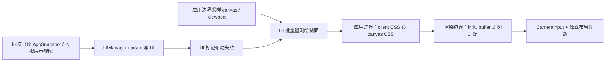

# PAO-19：HUD 到镜头的动态安全区接入设计

2026-11-04（Asia/Shanghai），候选 v0.1，Architectural 路径。**本稿仅供审查，未批准实施；没有新增运行时接口或验证成绩。**

## 1. 范围和事实基线

推荐由 UI 登记实际绘制面、按需量测，以带布局代次的只读数值快照，经应用边界归一化、渲染边界单位适配后送入镜头。镜头不查询 DOM，也不反写 UI、人物或模拟。详细候选结构、换算和 RED 矩阵见 [接口契约](../../ui/pao19-hud-safe-area-contract.md)；固定输入及本轮检查见 [证据登记](../../evidence/PAO-19/hud-safe-area-preparation/v1/README.md)。

本树基线 `ed39cb9aad981da1e9eda0a196b86d0c0c6702d9` 的原 UI 已验收，两个 P2 已关闭。旧 UI 规格中的“待批”、55% 底卡、底部双列道具是准备历史；实际竖屏底卡限高和侧列道具以已验收 CSS 为准。本稿不重新批准四页样式、不改布局、不重开 P2。

PAO-18 只读参考固定提交 `826b10fd8c6200fbaec02a76f4ec9d5482d5bb12`：

- `src/render/cameraRig.ts` 的 `CameraInput` 只有 width/height、可选 safeArea/reservedRects/reducedMotion，没有 canvasRect/layoutRevision/profile。
- `src/render/babylon.ts` 的 `setPresentationOptions(Partial<CameraInput>)` 是现有局部入口；render 取 engine drawing-buffer 宽高，再展开 options。不能只传 CSS rect 而继续使用 buffer 宽高。
- `projectActors` 检查三个角色的投影、边界和矩形相交；现有求解器围绕四边 safeArea 调整构图，**并非任意矩形绕障求解器**。暂停和 GAMEOVER 的已初始化 rig 直接返回；MENU/SHOP 的环绕分支也不执行该遮挡求解。
- `docs/render/pao18-interface-and-validation.md` 的 I-18U 是候选请求，不是已实现的动态 UI 桥。legacyHudProfile 固定边距只兼容旧 UI。

不读取 PAO-18 活动工作树、草稿或事件桥；不新增 I-03 事实协议。当前两个分支尚未集成，不能将各自能力相加作为实装结论。车尾/独立预览 KI-001/002、字体、17 主题及新 runner/音频重构均不在范围。

## 2. 路线比较

| 路线 | 收益 | 代价和限制 | 裁定建议 |
| --- | --- | --- | --- |
| A：UI 登记并量测，发布带 revision 的值；应用/渲染边界适配 | 页面、可见性和清理责任归 UI；可覆盖文本换行、道具和滚动；可独立验证几何与投影 | 需要失效/采样协议、少量边界接线；现有镜头的无解仍须暴露 | **推荐**；首批交付几何桥和诊断，不默认重构求解器 |
| B：main 直接查询 UI DOM | 少一个 producer 门面，初次接线短 | 选择器、转场和重建清理由共享入口承担；易漏卡片、用旧 rect；与 UI 并行修改冲突大 | 不推荐；main 只读取 canvas/viewport 数值并调公开门面 |
| C：固定页型/边距 profile | 无 DOM 读开销，兼容旧入口容易 | 长数字、200% 字体、多道具、toast、视口变化无法准确覆盖；无法证明实际占区 | 只保留明确版本的旧 UI 兼容回退，不作为新 UI 测量成功 |

A 的“实际”指可见绘制面的轴对齐边界与裁剪交集，不承诺像素级透明度分析、圆角镂空或精确遮挡优化。快照区分原始占区和相机保守包络，不能把后者伪称为真实 HUD 形状。

## 3. 数据流与职责

候选共享值模块为 `src/presentation/hudSafeArea.ts`，仅含数值类型、校验和纯换算；不导入 DOM/Babylon，不进入 application/types 或存档。UIManager 追加量测/失效订阅门面，保留 constructor/readApp/update、命令回执和全部原交互。应用捕获同次页面与 UI 量测基准；renderer 接收复制且深只读的值，不接收 HTMLElement、DOMRect 活对象或回调查 DOM。

应用边界做一次 client→canvas 局部 CSS 坐标转换；renderer 在当前 buffer 尺寸已知后做一次 CSS→buffer 转换，将完整 width/height/safeArea/reservedRects 原子送给原 CameraInput。layoutRevision/profile/lifecycle 留在外围租约及诊断，不擅自添加到固定 CameraInput，更不挤入 PAO-18 的事实帧协议。

`safeInsets` 仅表示设备安全边界/可视裁剪边界；HUD 每个实体绘制面另列 reservedRects。应用可以给明确 edge-top 登记组生成保守上沿构图包络：top=max(设备/可视边界, 该组可见底边+4 CSS px)，其余边不由零散按钮或侧列任意扩成整带。包络来源和原始矩形同时保存。这样现有四边求解器获得有限可用的顶部约束，侧列/Toast 仍以精确矩形检查；这并不保证所有空间有解。包络策略的选择和 4px 间隙列为审批项。

不在 main 调用相机 solver，也不让 render 从字符串、分数或道具时间推断布局。业务命令、未知提交重试、字段音频事务和局身份不经几何通道修改。

## 4. 页面、生命周期与更新时序

| 页面/profile | 发布内容 | 镜头策略 |
| --- | --- | --- |
| PLAYING / gameplay | 实际徽章、速度卡、声音/暂停按钮、可见道具、Toast、非空反馈绘制面 | 有效布局才启用动态约束；沿用有界现有 solver，输出真实最终冲突 |
| MENU / menu | 完整可见实体底/侧卡，内容以卡片外框去重，透明屏幕不占区 | 仅诊断；保留已验收菜单取景，不因本桥自动重做菜单镜头 |
| PAUSED / modal | 模态标记、可见卡片和背景仍可见的 HUD | 冻结相机姿态/表现游标；旋转和布局变化只重算投影诊断，不推进 dt 或偷偷补动画 |
| SHOP / modal | 实体商店卡与遮罩语义 | 不要求角色避开整个模态页；保留原菜单/商店镜头行为，不把 modal 当无解追逐目标 |
| GAMEOVER / modal | 实体结算卡、保存/错误内容，完整遮罩语义 | 沿用结束时冻结；可以更新诊断，不为避开结算卡逃离场景 |

所有页面都提供可见几何，模态遮罩另列 `modal` 语义。半透明全屏遮罩不放入普通 reservedRects；不透明卡片必须登记。inert 只约束交互，不能排除仍绘制的暂停背景 HUD。

UI 实例有 producerId；reset 增 epoch；有效语义/几何变化增 layoutRevision。租约身份为三者组合，runId/page 仅作关联，不拿 null-runId 复用跨次菜单访问的旧布局。重建先释放旧租约，旧 observer、rAF、字体 promise 和订阅回调均检查实例/epoch。页面变化及退出 PLAYING 先失效旧页布局，不等首个新 rect 才通知。

更新采用 dirty 合并：UI 写阶段只在实际文本/显隐/子节点变化时标记；ResizeObserver、scroll、window/visualViewport resize/scroll、字体就绪与加载事件也只置 dirty。同一帧 UI 写完，应用协调的单一读阶段批量采样 canvas、viewport、安全区探针和登记面；与同次 render 绑定后提交。不在每个 render 无条件 getBoundingClientRect，不在 observer 回调改布局。迟于本帧读阶段的失效留到下一次读阶段；这一帧标为过期，不声称安全。

不另开第二个游戏循环。若现有帧顺序无法做到 UI 写→读→render，由 Dispatcher 决定在唯一入口调整最小调用顺序；不以不同 rAF 队列的偶然顺序保证一致性。转场期间每帧最多一次采样，转场结束补采样；无动画且不 dirty 时只读缓存。后台不追跑，恢复先失效再采样。暂停仍允许浏览器布局读和诊断，绝不模拟补步。

几何不可用只冻结本桥涉及的相机更新，不能短路角色/实体 render 或事实桥消费，也不能积累等待时长后补跑镜头震动。触摸/键盘处理和 PAO-18 事件去重继续沿用各自权威入口。

## 5. 失败、回退与性能边界

新 UI 量测未就绪、canvas 脱离文档/零尺寸、可视交集空、非法 rect、布局代次过期时，禁用该动态输入并发诊断。相同实例、页面、epoch、canvas/viewport 基准且未 dirty 的最近快照可重用，不按墙钟无故过期；一旦 dirty 不能无限沿用。缺一个仍可见登记面的有效几何时，整批 unavailable，不能丢掉它后报 safe。

新桥 active 但首帧无数据：保持当前相机姿态；未初始化时只保留 renderer 既有初始姿态，不启动未知布局的避让。标为 UNREADY，不把旧 legacy profile 冒充新 UI 安全。仅没有启用新 producer 的旧 UI 路径继续明确版本的 legacyHudProfile。释放时清除新桥持有的选项，恢复宿主原选项，不能残留最后一页 rect。

空间无解或现有 reservedRects 只能诊断不能消解时，报告 FRAMING_CONFLICT/NO_SAFE_REGION，并保留现有有界相机行为和最终投影事实；不移动/缩小人物、不改模拟追逐距离、不藏犬、不缩字号、不改变 UI 来凑通过。旋转中的暂停帧可能由原冻结姿态导致投影冲突，须如实报告 frozen，而不是强行宣称可见或暗中重构镜头。若需求升级为暂停也重构图、菜单动态取景或任意矩形求解，另提独立最小请求和 RED。

CSS transform 的 canvas 旋转/skew/perspective、非矩形 clip-path/mask 不在首批换算支持范围；检测到即 unsupported，而非按 AABB 假装精确。允许普通平移/正向轴对齐缩放，前提是使用绘制内容框且无未计入的 border/padding；相关浏览器差异需后续 F 用例实测。

诊断只记录布局身份、页型、原因、样本/使用帧、几何和最终投影；同原因/身份限一次，不写 localStorage、不发业务事件，不记录钱包/音频内容。正常稳定帧没有强制 DOM 重排；实际读次数和耗时作为后续证据，不在本稿承诺设备帧率。

## 6. 未来最小白名单请求与串行接线

以下是**候选扩围**，本轮均未解锁。公共命名、接入提交及顺序由 Dispatcher 冻结；不在 PAO-18 事件桥进行中抢写入口。

| 候选文件 | 最小职责/写权 |
| --- | --- |
| `src/ui/dom.ts` | 登记已有绘制面、dirty 与批量量测；只对本桥新增监听做幂等释放；保留所有业务交互 |
| `src/presentation/hudSafeArea.ts`（新增） | 中立只读类型、矩形校验/裁剪、client→CSS→buffer 纯函数；不扩全局业务 types |
| `src/main.ts`（后续独占） | UI 写/读/render 顺序、canvas/viewport 同批读、producer 租约订阅和释放；不触及 I-03/交易/音频 |
| `src/render/babylon.ts`（18 交接后独占） | 数值 setter/租约、当前 buffer 换算、页型策略、冻结时只读投影诊断；保留 setPresentationOptions/reducedMotion 等已有参数 |
| `tests/unit/pao19-hud-safe-area.test.ts`（新增） | 纯几何、revision/epoch、生命周期/合并传感器 |
| `tests/unit/pao19-hud-camera-adapter.test.ts`（新增） | buffer 单位、页型/冻结、无解和清理的边界传感器 |
| `tests/e2e/rebuild-ui.spec.ts` | 追加真实 DOM/投影 N/F 回归，保留所有旧断言及 PAO-6 已批准单行 |

首批不需要 views/screens、CSS、HTML、cameraRig.ts 或公共 application/types 的改动。登记用 UI 内部已有节点引用；env 通过 UI 创建的非交互测量探针解析为 px，无须改样式表。若投影诊断确不能在 babylon 门面复用导出的 projectActors，才请求 `src/render/cameraRig.ts` 的只读诊断门面；不得借此改 solver。

建议批准后的顺序：Dispatcher 先同步共享规范并冻结接缝/白名单；UI producer 与纯函数先 RED→GREEN、检查公开门面；待 PAO-18 共享入口释放，单一接线方串行改 main/babylon；最后完整回归和独立主审。阶段检查不解除 PAO-18 原依赖，不自行合并分支。实现计划须在设计批准后再用 writing-plans 编写。

## 7. 待决项与验收门禁

需主 Agent 统一并送用户批准的是：新中立值模块的名称/归属、三元布局身份与数值 setter；顶部保守包络及 4px 间隙；菜单/模态只诊断、暂停严格冻结的范围；失效首帧保持姿态的回退；共享入口串行窗口与最终接入基线。都不是重审已验收 UI、M1 或事件桥。

详细 [RED 矩阵](../../ui/pao19-hud-safe-area-contract.md#8-后续-red-与验收矩阵全部待执行) 将 DOM 几何正确与真实角色投影正确分开；不把送入 reservedRects 当避让成功。后续代码批次必须 build/test/完整 E2E、N/F 分报、独占服务/raw 源码及前后 hash/旧证据恢复、稳定截图；默认主审查看 2–3 张，有异常再扩大。真机未测须列明。

本轮只新增三份文档、内容与引用审查、diff 检查、正常 hooks 提交推送；不写测试、不跑新浏览器实验、不用历史 build/252 单测/60 E2E 当动态桥成绩。方法采用已读取的本地 brainstorming 技能；Architectural 分类和批准后才能实施的门禁来自项目 AGENTS/SUPERPOWERS_WORKFLOW 与本次任务说明，输出位置和仅设计范围遵循本次明确授权。
